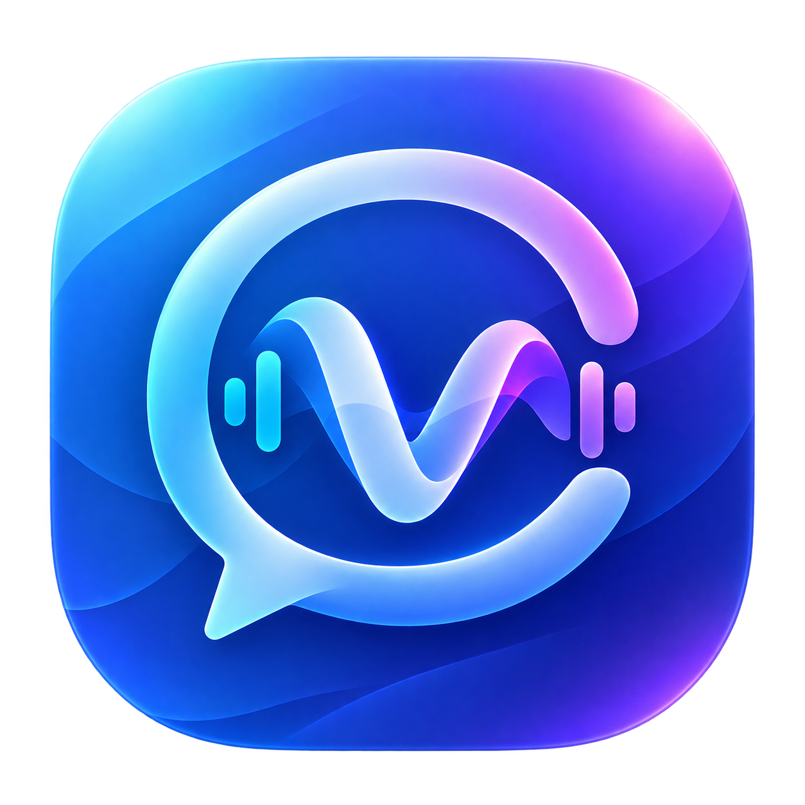
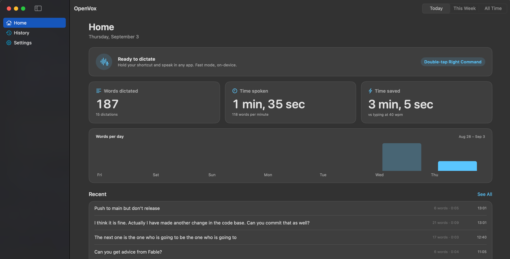

<div align="center">
  
  <h1>OpenVox</h1>
  <p>Tap. Speak. In any app.</p>
  <p>
    <a href="https://github.com/0xAnto/openvox/actions/workflows/ci.yml"></a>
    <a href="https://github.com/0xAnto/openvox/releases/latest"></a>
  </p>
  
  <p><a href="https://github.com/0xAnto/openvox/releases/latest"><strong>Download for macOS</strong></a></p>
</div>

OpenVox is on-device dictation for macOS. Hold a key, speak, and the text
appears at your cursor in any app. Your audio stays on your Mac.

## Features

- **Any app.** Mail, a terminal, a web page: the text goes where your cursor is.
- **Hold or tap.** Hold Right Option to talk, or tap it once to keep your hands free. Escape cancels.
- **Your keys.** Change the dictation key, use a double tap, and pick the mic in Settings.
- **History.** Search and copy past dictations. Keep them for 7 days, 30 days, or forever.
- **Private.** Speech recognition runs on your Mac. Your audio never leaves it.

## Models

| Mode | Model | What it does |
| --- | --- | --- |
| **Standard**, Balanced | [Moonshine](https://huggingface.co/moonshine-ai/moonshine-streaming) small | Types when you release the key. The default. |
| **Standard**, Best | [Phonon-2](https://huggingface.co/FermionResearch/Phonon-2) | Same, with a third fewer errors. Uses more memory. |
| **Live** | [Nemotron Speech Streaming 0.6B](https://huggingface.co/nvidia/nemotron-speech-streaming-en-0.6b) | Types while you speak. |

The app downloads a model the first time you use it. See the
[benchmarks](docs/benchmarks.md) for how we picked them.

## Install

Requires macOS 14 or later on Apple silicon, and
[`uv`](https://docs.astral.sh/uv/) (Homebrew) or Python 3.10 or later.

1. Download the `.dmg` from [Releases](https://github.com/0xAnto/openvox/releases/latest).
2. Drag `OpenVox.app` to Applications.
3. The builds are not notarized, so remove the quarantine flag:
   ```bash
   xattr -dr com.apple.quarantine /Applications/OpenVox.app
   ```
4. Open the app, follow the setup, and give Microphone and Accessibility access.

After each update, remove OpenVox from **System Settings > Privacy & Security >
Accessibility** and add it again. The toggle alone does not work.

> **Bluetooth speakers and headsets:** a Bluetooth mic mutes music while you
> dictate. To keep music playing, pick the MacBook mic in Settings.

## Build from source

```bash
git clone https://github.com/0xAnto/openvox.git
cd openvox/mac
./scripts/build-app.sh            # builds and installs to /Applications
swift build && .build/debug/OpenVox --selftest
```

A local build replaces `/Applications/OpenVox.app`. Set `CI=1` to keep the
bundle in `mac/` instead.

## Contributing

Issues and pull requests are welcome. Each merge into `main` publishes a new
release.

## Credits

- [Phonon-2](https://huggingface.co/FermionResearch/Phonon-2) by Fermion
  Research, derived from NVIDIA's
  [Parakeet TDT 0.6B v3](https://huggingface.co/nvidia/parakeet-tdt-0.6b-v3),
  under [CC BY 4.0](https://creativecommons.org/licenses/by/4.0/).
- `mac/sidecar/phonon2.py` adapts code from
  [fermion-research](https://github.com/fermionresearch/phonon) under the
  Apache License 2.0. See `mac/sidecar/LICENSE-fermion.txt`.
- [Moonshine](https://huggingface.co/moonshine-ai/moonshine-streaming) by
  Moonshine AI, and
  [Nemotron Speech Streaming](https://huggingface.co/nvidia/nemotron-speech-streaming-en-0.6b)
  by NVIDIA.
